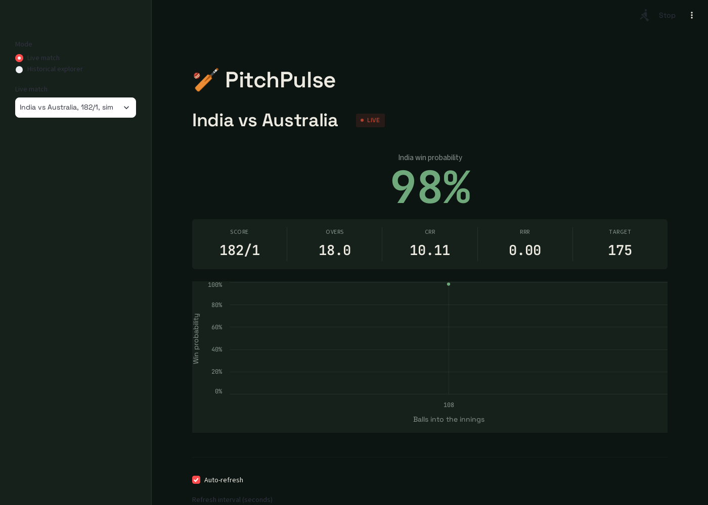
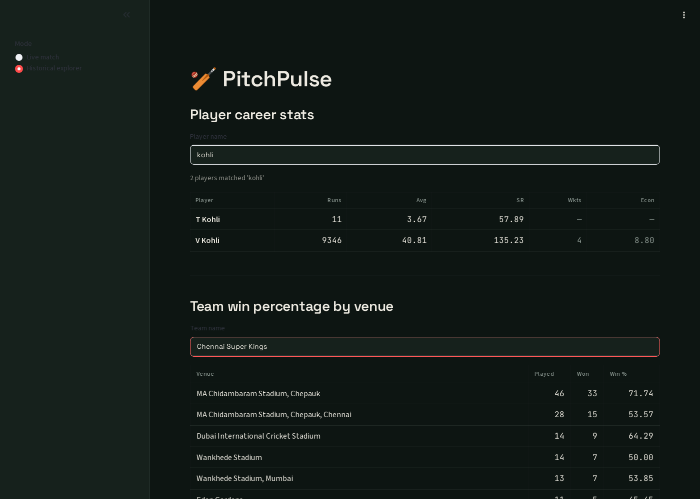

# PitchPulse

PitchPulse is a cricket analytics platform that combines a historical batch pipeline with a live streaming pipeline into a single API and dashboard. Historical ball-by-ball data (via Cricsheet) is loaded into a Postgres warehouse and transformed with dbt into analytics-ready tables, which are used to train a win probability model. During a live match, a streaming pipeline (Kafka + a Python producer/consumer) ingests real-time updates, maintains current match state in Redis, and applies the trained model to produce a live-updating win probability. A FastAPI service exposes both the historical stats and the live match state, and a Streamlit dashboard visualizes both.

<p float="left">
  
  
</p>

## Status

This project is being built phase by phase. Current progress:

- [x] Phase 0: environment and project setup
- [x] Phase 1: batch pipeline (Postgres warehouse, loader, Airflow DAG, dbt models)
- [x] Phase 2: streaming pipeline (Kafka producer/consumer, Redis state)
- [x] Phase 3: win probability model (feature engineering, training, evaluation)
- [x] Phase 4: serving API and dashboard (FastAPI, Streamlit)
- [x] Phase 5: testing, CI, documentation, polish
- [ ] Phase 6 (optional): cloud deployment

## Architecture

See [`docs/architecture.md`](docs/architecture.md) for the diagram and a
component-by-component writeup. In short:

```
Historical archive (Cricsheet)          Live match feed (cricket API)
        |                                        |
        v                                        v
  Batch pipeline                          Streaming pipeline
  (Airflow schedules a                    (Python poller -> Kafka
   loader script + dbt)                    topic -> Python consumer)
        |                                        |
        v                                        v
  Warehouse (Postgres,                    Real-time store (Redis,
  analytics tables)                       current match state)
        |                                        |
        +------------------+---------------------+
                            v
                     Serving API (FastAPI)
                            |
                            v
                       Dashboard (Streamlit)
```

The win probability model is trained offline from warehouse data and loaded inside the streaming consumer, so every live update also produces a live probability written to Redis alongside the match state.

## Tech stack

- **Language**: Python 3.11+
- **Historical data**: Cricsheet (free, no auth)
- **Live data**: a free-tier cricket API (e.g. CricAPI)
- **Message queue**: Apache Kafka (KRaft mode, single broker)
- **Orchestration**: Apache Airflow
- **Transformation**: dbt (dbt-postgres)
- **Warehouse**: PostgreSQL 16
- **Real-time store**: Redis 7
- **ML**: scikit-learn, pandas, joblib
- **API**: FastAPI + Uvicorn
- **Dashboard**: Streamlit
- **Containerization**: Docker + Docker Compose
- **CI**: GitHub Actions

## Quickstart

Fresh clone to a running dashboard. See "Build notes" further down for the
detailed rationale behind each piece.

### 1. Prerequisites

Docker and Docker Compose (Compose v2 -- `docker compose`, not the older
standalone `docker-compose`).

### 2. Configure

```bash
cp .env.example .env
```
Then edit `.env`:
- `AIRFLOW_UID` — on Linux/WSL, set this to your host user's UID (run `id -u`).
  Airflow's container needs it to write to bind-mounted folders; 1000 (the
  default) is correct for most single-user Linux/WSL setups.
- `LIVE_CRICKET_API_KEY` — only needed to poll a **real** live match (free key
  at [cricapi.com](https://cricapi.com)). The historical pipeline, model
  training, and the dashboard's simulated live-match demo all work without it.

### 3. Download historical data

```bash
wget https://cricsheet.org/downloads/ipl_male_json.zip -P data/
unzip data/ipl_male_json.zip -d data/ipl_raw
```

### 4. Bring up the stack

```bash
docker compose up -d
```
This starts Postgres, Kafka, Redis, Airflow, the API, and the dashboard.
`kafka-init` runs once (creates the Kafka topic) and exits — that's expected,
not a failure. The streaming producer/consumer are intentionally **not**
started by this command; see step 8.

Give it a minute, then check everything's up: `docker compose ps` (everything
should show `Up`, most `healthy`).

### 5. Load historical data and build the warehouse

Open the Airflow UI at <http://localhost:8080> (see "Phase 1: batch pipeline"
below for the login), unpause and trigger `pitchpulse_batch_pipeline` — or
from the CLI:
```bash
docker compose exec airflow airflow dags unpause pitchpulse_batch_pipeline
docker compose exec airflow airflow dags trigger pitchpulse_batch_pipeline
```
This parses the downloaded JSON into Postgres and runs `dbt build`, which is
what the dashboard's historical tab reads from.

### 6. Train the win probability model

```bash
python3 -m venv .venv && source .venv/bin/activate
pip install -r ml/requirements.txt
POSTGRES_HOST=localhost python ml/feature_engineering.py
POSTGRES_HOST=localhost python ml/train_win_probability.py
POSTGRES_HOST=localhost python ml/evaluate.py   # optional sanity check
```
This saves `ml/model/win_probability_model.pkl`. If the streaming consumer is
already running, restart it to pick the model up
(`docker compose --profile streaming restart consumer`); otherwise it'll pick
it up the next time it starts.

### 7. Open it

- Dashboard: <http://localhost:8501>
- API docs: <http://localhost:8000/docs>

The historical tab works as soon as step 5 finishes. For the live tab, see
the next step.

### 8. Live match streaming (optional)

```bash
docker compose --profile streaming up -d consumer
docker compose --profile streaming run --rm producer python ingestion/streaming/simulate_match.py demo --interval 2 --target 175
```
This simulates a live match with no API key and no quota spent — refresh the
dashboard's live tab and pick `sim-demo`. For an actual live match, see
"Phase 2: streaming pipeline" below for the real producer and CricAPI's daily quota.

## Testing & CI

```bash
pip install -r tests/requirements.txt
pytest tests/ -v
```
21 unit tests cover the Cricsheet JSON parsing logic (`load_cricsheet.py`), the
train/test split + feature-cleaning logic (`feature_engineering.py`), and the
over/ball/balls-remaining bookkeeping in the match simulator
(`simulate_match.py`) — all pure Python/pandas, no database needed.

`.github/workflows/ci.yml` runs on every push: spins up a Postgres service
container, creates the (empty) raw schema, runs `dbt build` against it —
building all 6 models and running all 26 dbt tests, which pass vacuously
against zero rows, enough to confirm the SQL and test definitions are valid
without downloading the full dataset in CI — then runs the pytest suite.

## Build notes (phase by phase)

The condensed setup is above; this section is the detailed rationale and
context behind each phase, including a couple of real bugs found and fixed
along the way.

### Phase 0 (done)

1. Copy `.env.example` to `.env` and fill in real values, especially `LIVE_CRICKET_API_KEY` (sign up at cricapi.com or a RapidAPI cricket API for a free key).
2. Historical IPL data is downloaded from Cricsheet into `data/ipl_raw/` (gitignored — re-download with the command below on a fresh clone):
   ```bash
   wget https://cricsheet.org/downloads/ipl_male_json.zip -P data/
   unzip data/ipl_male_json.zip -d data/ipl_raw
   ```

### Phase 1 (done): batch pipeline

Postgres (warehouse) and Airflow (orchestration) now run via Docker Compose. On
Linux/WSL, set `AIRFLOW_UID` in `.env` to your host user's UID (`id -u`) first —
Airflow's container needs to write to the bind-mounted `dags/`, `dbt/`, and
`data/` folders, and this keeps file ownership matching.

```bash
docker compose up -d postgres airflow
```

This brings up:
- **Postgres** on `localhost:5432`, with two databases in one instance: `pitchpulse`
  (the warehouse) and `airflow` (Airflow's own metadata), created automatically
  by `postgres/init-airflow-db.sh` on first startup.
- **Airflow** (single container, `airflow standalone` mode: webserver + scheduler
  + triggerer) on `http://localhost:8080`. dbt runs from its own virtualenv baked
  into the Airflow image (`/opt/dbt_venv`), kept separate from Airflow's own
  Python dependencies since dbt-core and Airflow pin conflicting versions of
  several shared packages.

**Note on deviating from the spec:** rather than Airflow's official multi-container
quickstart (webserver, scheduler, triggerer, worker, flower, its own Postgres/Redis),
this project runs Airflow as a single container in `airflow standalone` mode
(LocalExecutor), pointed at the same Postgres instance as the warehouse. That
quickstart is built for Celery-based horizontal scaling, which is unnecessary
overhead for a single local DAG in a portfolio project; `standalone` still runs
the real webserver, scheduler, and triggerer processes, just in one container.

Log into the Airflow UI with `admin` / whatever password you set (see below),
find the `pitchpulse_batch_pipeline` DAG, and trigger it. It runs two tasks:
1. `load_raw_data` — parses every Cricsheet JSON file in `data/ipl_raw/` into
   `raw_matches` and `raw_deliveries` in Postgres (safe to re-run; upserts skip
   rows that already exist).
2. `run_dbt` — runs `dbt build`, which creates the staging views and mart
   tables (including `match_state_features`, the training table for Phase 3)
   and runs all dbt tests.

The DAG can also be triggered from the CLI:
```bash
docker compose exec airflow airflow dags unpause pitchpulse_batch_pipeline
docker compose exec airflow airflow dags trigger pitchpulse_batch_pipeline
```

On first startup, Airflow creates an `admin` account with a random password
written to `/opt/airflow/standalone_admin_password.txt` inside the container
(`docker compose exec airflow cat /opt/airflow/standalone_admin_password.txt`).
If that file isn't there, set a known password instead:
```bash
docker compose exec airflow airflow users reset-password --username admin --password <your-password>
```

### Phase 2 (done): streaming pipeline

Kafka (KRaft mode, single broker) and Redis now run via Docker Compose alongside
Postgres and Airflow:

```bash
docker compose up -d redis kafka kafka-init
```

`kafka-init` creates the `live-match-events` topic (1 partition) and exits —
that's expected, it's a one-shot job, not a long-running service.

The producer and consumer are gated behind the `streaming` Compose profile, so
they never start with a plain `docker compose up -d` — the producer should
only run while you're actually watching a match, not continuously, to respect
CricAPI's free-tier quota of 100 requests/day. **This project polls every 2-3
minutes (randomized) instead of the usual 10-15 seconds** for that reason —
even so, a full ~3.5 hour T20 uses roughly 70-105 requests, close to the whole
daily budget, so only run the producer against a real match when you actually
intend to watch it.

```bash
# build the images once
docker compose --profile streaming build

# start the consumer (always listening, applies the model, writes to Redis)
docker compose --profile streaming up -d consumer

# start the producer against a real live match id (from CricAPI's
# currentMatches endpoint), OR set LIVE_CRICKET_MATCH_ID in .env and run
# `docker compose --profile streaming up -d producer` instead
docker compose --profile streaming run --rm producer python ingestion/streaming/producer.py <match_id>
```

**Testing/demoing without spending API quota:** `simulate_match.py` publishes a
fabricated but plausible run chase straight to Kafka, in the same message
schema the real producer uses, so you can exercise the consumer, Redis, the
API, and the dashboard without touching CricAPI at all:
```bash
docker compose --profile streaming run --rm producer python ingestion/streaming/simulate_match.py demo-001 --interval 1 --target 175
```
Then check the result: `docker compose exec redis redis-cli GET match:sim-demo-001:state`.

Every simulated match_id is automatically namespaced under `sim-` (so
`demo-001` above becomes `sim-demo-001`), and by default the script cleans up
its own Redis key and `live_events_log` rows a few seconds after the
simulated innings finishes -- so running it repeatedly during development
doesn't leave stale entries cluttering the dashboard's live-match dropdown.
Pass `--no-cleanup` to keep a simulated match's data around on purpose (e.g.
to leave it visible in the dashboard for a while).

The consumer also creates a `live_events_log` table in Postgres and appends
every event to it, so live matches can be replayed/analyzed afterward.

**Note:** until Phase 3 trains and saves a model to `ml/model/win_probability_model.pkl`,
the consumer runs fine but writes `win_probability: null` into each match's Redis
state (it logs a warning once at startup). Restart the consumer after Phase 3
to pick up the trained model — no rebuild needed, `ml/` is bind-mounted.

### Phase 3 (done): win probability model

Trains on the `match_state_features` mart (Postgres must have data loaded —
see Phase 1). Not containerized (per the spec, this is fine to run from a venv);
tested here via a throwaway container on the compose network instead of a host
venv, but either works:

```bash
python3 -m venv .venv && source .venv/bin/activate
pip install -r ml/requirements.txt
# with POSTGRES_HOST=localhost (or whatever resolves to your Postgres) in the environment:
python ml/feature_engineering.py      # prints train/test split sizes, saves feature_list.json
python ml/train_win_probability.py    # trains both models, saves the better one + evaluation_report.txt
python ml/evaluate.py                 # sanity-checks the saved model against hand-picked scenarios
```

Splitting is done by `match_id` (never mid-match), so no match's deliveries leak
between train and test. Both a `LogisticRegression` baseline and a
`GradientBoostingClassifier` are trained on `runs_needed`, `balls_remaining`,
`wickets_in_hand`, `current_run_rate`, `required_run_rate`; whichever scores
higher AUC on the held-out test set is saved as `win_probability_model.pkl`.
Current result (from `ml/model/evaluation_report.txt`):

```
Model                        AUC       Log loss
LogisticRegression           0.8904    0.4107
GradientBoostingClassifier   0.8922    0.4088
Selected model: GradientBoostingClassifier
```

`ml/evaluate.py`'s sanity check confirms the model's predictions track cricketing
intuition, e.g. needing 5 off the last ball with 1 wicket in hand scores ~4.5%,
while needing 5 off 12 balls with 8 wickets in hand scores ~98%.

**Note on `numpy`/`scikit-learn`/`joblib` version pinning:** these are pinned to
*exact* matching versions in both `ml/requirements.txt` and
`ingestion/streaming/requirements.txt`. joblib's pickle format for a fitted
scikit-learn model isn't guaranteed compatible across numpy/scikit-learn
versions, and training with a newer version than the streaming consumer has
installed will crash the consumer on `joblib.load()`. If you change one, change
the other to match, then rebuild the consumer image.

**Note on `ml/evaluate.py` and the live consumer's edge cases:** the model is
only ever trained on "about to face this ball" states, where the minimum
`balls_remaining`/`wickets_in_hand` seen is 1, never 0 (once either hits 0 the
innings is over and no further training rows exist). The live consumer
(`ingestion/streaming/consumer.py`) reports *post-ball* state, so on the final
ball of a completed innings it can legitimately see `balls_remaining: 0`. Rather
than feed the model that out-of-distribution input, `compute_win_probability()`
short-circuits to a deterministic 0.0 or 1.0 whenever the innings has
effectively ended (no balls or no wickets left) instead of calling the model.

### Phase 4 (done): serving API and dashboard

```bash
docker compose up -d api dashboard
```

- **API** (FastAPI) on `http://localhost:8000`, interactive docs at `/docs`.
  - `GET /health` — liveness check
  - `GET /historical/player/{player_name}` — career batting/bowling stats from `player_career_stats`
  - `GET /historical/team/{team_name}/venues` — win% by venue from `team_venue_performance`
  - `GET /historical/phase-trends?team=&season=` — phase-wise run rate trends (both params optional)
  - `GET /live/matches` — match_ids currently tracked in Redis
  - `GET /live/match/{match_id}` — full current state + win probability for one match, 404 if not tracked
- **Dashboard** (Streamlit) on `http://localhost:8501`, with a sidebar mode toggle:
  - **Live match**: score, current/required run rate, win probability, and a
    live-updating win probability line chart. The chart is built client-side —
    each auto-refresh (every few seconds, or a manual "Refresh now" button)
    polls `/live/match/{id}` and appends the new point to that match's history
    kept in the browser session, since the API itself only ever returns the
    latest snapshot.
  - **Historical explorer**: player search, team win% by venue table, and a
    phase-wise run rate bar chart (one bar series per season).

Both containers bind-mount their source directories, so editing `api/` or
`dashboard/` code takes effect immediately (uvicorn `--reload` / Streamlit's
own file watcher) without rebuilding the image.

**Verification:** endpoints were checked with `curl` against real IPL data and
a live Redis match state; the dashboard was checked by actually driving it in
a headless browser (Playwright, since no dev-container display/browser was
available) and screenshotting each view — this caught a real bug where the
run-rate metrics used `value or "—"`, which silently hid genuine `0.0` values
(e.g. a chase that has already reached its target) behind the "no data"
placeholder. Fixed to check `is not None` explicitly.

**Post-phase-4 fixes:**
- `/historical/player/{name}` was doing an exact, case-sensitive match, so
  "Dhoni" or "kohli" found nothing (Cricsheet stores "MS Dhoni", "V Kohli").
  It's now a case-insensitive partial match (also applied to the team filters
  on the other two historical endpoints) and always returns every match —
  earlier it also silently capped results at 10 while still reporting that
  capped count as if it were the true total (e.g. "sharma" matches 21 players;
  it said "10" and dropped the rest, including RG Sharma). There's no
  realistic row-count risk here (the mart has on the order of a thousand
  players total), so the fix is simply not capping the query rather than
  adding pagination.
- The live-match dropdown showed raw match_ids (a CricAPI UUID, or a
  `sim-...` test id) instead of anything readable. It now shows
  `{batting_team} vs {bowling_team}, {score}, sim` via Streamlit's
  `format_func`, resolved from each tracked match's live state.
- `simulate_match.py` now forces every simulated match into a `sim-` prefix
  namespace and self-cleans its Redis key + `live_events_log` rows a few
  seconds after finishing (pass `--no-cleanup` to keep one around
  deliberately), so repeated test runs no longer pile up stale entries in the
  live-match dropdown.
- The dashboard's visual design was reworked from Streamlit's default look to
  a deliberate one grounded in a floodlit night match: a near-black
  green-tinted background, pitch-green as the one primary accent, ball-red
  held back exclusively for live/urgent signals (the "LIVE" badge), Space
  Grotesk for headings, and JetBrains Mono with tabular figures for every
  live/constantly-updating number so digits don't jitter in width as they
  change. Win probability is the visual hero of the live tab (large, not
  boxed in a metric card); score and run rates read as one scoreboard-style
  strip beneath it; the historical player search renders as compact
  scorecard rows rather than a card grid. All of `st.metric` and the default
  bordered-card look were replaced with hand-built HTML/CSS for full control.
  Iterated against screenshots taken with the same Playwright setup used for
  phase 4's original verification, which caught two real bugs along the way:
  a blanket `font-family` CSS override that broke Streamlit's own icon font
  (rendered as literal text like "keyboard_double_arrow_left" instead of an
  arrow glyph), and a 3-color cycle for the phase-trends chart's per-season
  colors that repeated identical colors once there were more than 3 seasons
  in view — replaced with a true interpolated gradient between two tones of
  the accent color, sized to however many seasons are actually present.

### Phase 5 (done): testing, CI, documentation, polish

See "Testing & CI" above for how to run the suite. A few notes:
- Tests are pure unit tests (no DB, no network) so they run the same way
  locally and in CI: `tests/test_load_cricsheet.py` hand-builds a small
  Cricsheet-shaped match dict (real Cricsheet JSON lives under the gitignored
  `data/`, which won't exist in a fresh clone or in CI) and checks
  `parse_match_row`/`parse_delivery_rows` against it directly, including edge
  cases like a wide (illegal delivery, still gets a row) and a wicket.
  `tests/test_feature_engineering.py` checks `clean_features` and
  `split_by_match` (the by-match-id, no-leakage train/test split) against
  small synthetic DataFrames.
- `conftest.py` at the repo root puts `ingestion/batch/` and `ml/` on
  `sys.path` so tests can `import load_cricsheet` / `import
  feature_engineering` directly — neither directory is a package, since both
  are meant to be run as standalone scripts.
- CI's `dbt build` step needed the raw tables to exist before dbt's staging
  models (which select from them as sources) would even compile, but
  downloading the full Cricsheet archive just for a schema check felt like
  the wrong tradeoff for CI speed/reliability. It calls `ensure_schema()`
  directly (the same idempotent `CREATE TABLE IF NOT EXISTS` the loader uses)
  to create empty tables instead.
- The full `docker compose up -d` (every service in one command, per this
  phase's own checklist — notably *not* including the streaming
  producer/consumer, which stay behind the `streaming` profile on purpose)
  was verified from a cold `docker compose down` to confirm the Quickstart
  above is accurate, not just plausible.
- Real screenshots (`docs/screenshot_live.png`, `docs/screenshot_historical.png`)
  replace a demo GIF — a static image was enough to show the design, and
  didn't require additional tooling to record/encode a video.

### Post-phase-5 fix: `simulate_match.py` under-counted balls bowled by a full over

`consumer.py` (and the real `producer.py`) treat `over_number` as "how many
overs are fully complete", reconstructing balls bowled as
`over_number * 6 + ball_number`. `simulate_match.py`'s per-over loop emitted
its 0-indexed loop variable as `over_number` directly instead of `+1`, so
every single event under-reported balls bowled by a full over throughout the
whole simulated innings — not just cosmetically: `current_run_rate` was wrong
from the very first event, and at the last over specifically, `balls_remaining`
hit 0 a full over early, which made `compute_win_probability`'s "the innings
has already ended" short-circuit fire prematurely and force `win_probability`
to `0.0`/`1.0` instead of a real model prediction. Fixed by emitting
`over_index + 1` (completed-overs count) instead of the raw loop index.
`tests/test_simulate_match.py` now asserts the invariant that would have
caught it (`balls_bowled + balls_remaining == 120` for every event), verified
to actually fail against the old logic before being merged.

## Repository structure

See `docs/architecture.md` for the full architecture writeup. Top-level layout:

```
pitchpulse/
├── ingestion/                # batch loader + streaming producer/consumer
├── dags/                     # Airflow DAGs
├── dbt/                      # dbt project (staging + mart models)
├── ml/                       # feature engineering, model training, evaluation
├── api/                      # FastAPI service
├── dashboard/                # Streamlit dashboard
├── airflow/                  # custom Airflow image (Dockerfile + dbt venv)
├── postgres/                 # first-boot init script (creates the airflow db)
├── tests/                    # unit tests (+ requirements.txt)
├── docs/                     # architecture notes, diagram, screenshots
├── .github/workflows/ci.yml  # GitHub Actions: dbt build + pytest on every push
├── docker-compose.yml
├── conftest.py                # pytest sys.path setup for ingestion/ml imports
└── pytest.ini                 # pytest config (testpaths = tests)
```
